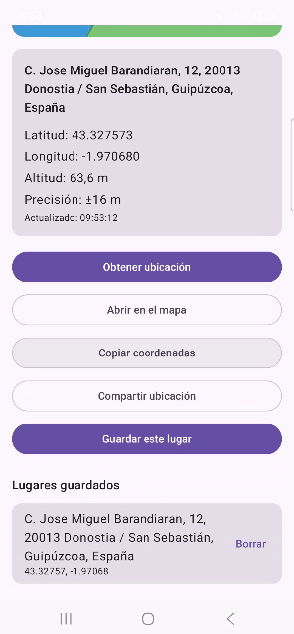

# GPSsaiakera

Android aplikazio bat, gailuaren kokapena lortzen duena eta eskuz marraztutako munduko mapa soil batean erakusten duena, erabiltzailearen kontinentera animazio bidezko zoom batekin. Gainera, lekuak hodeian gordetzeko aukera ematen du **Firebase** erabiliz.

Ariketa-proiektua, **Kotlin** eta **Jetpack Compose** erabiliz egina.

## Pantaila-argazkia

<p align="center">
  
</p>

<!-- Aukerakoa: gehitu goiko aldearen beste argazki bat munduko mapa eta zoomarekin:  -->

## Zer egiten du

- Aplikazioa irekitzean, kokapenerako baimena automatikoki eskatzen du.
- Baimena ematen den unean, uneko kokapena lortzen du, erabiltzaileak ezer sakatu beharrik gabe.
- Munduko mapa oso sinplifikatu batek (ozeano urdina, kontinente berdeak) planeta osoa erakutsiz hasten da, eta **zoom animatu** bat egiten du zu zauden kontinentera arte. Zure posizioa puntu gorri batekin markatzen da, pultsu-efektu batekin.
- Kokapenaren datuekin txartel bat erakusten du:
  - Helbidea testuan (alderantzizko geokodetzea)
  - Latitudea eta longitudea
  - Altuera, zehaztasuna, abiadura (km/h) eta norabidea puntu kardinalarekin, gailuak ematen dituenean
  - Irakurketaren ordua
- Hauek egiteko aukera ematen du: puntua mapa-aplikazio batean **ireki**, koordenatuak arbelera **kopiatu** eta kokapena Google Maps esteka batekin **partekatu**.
- **"Guardar este lugar"**: uneko kokapena Firebasen gordetzen du. Lekuak "Lugares guardados" zerrenda batean agertzen dira, denbora errealean eguneratzen dena; bat sakatzean mapan irekitzen da, eta **Borrar** botoiarekin ezabatzen da.
- "Obtener ubicación" botoiak posizioa berriro kontsultatzen du eguneratu nahi denean.

### Kasu mugakideak

| Egoera | Portaera |
|---|---|
| Baimena ukatuta | Azalpen-mezua eta berriro eskatzeko botoia |
| Baimena betiko ukatuta | Aplikazioaren ezarpenak irekitzen dituen botoia |
| Gutxi gorabeherako kokapenaren baimena soilik | Funtzionatzen du: doitasun handiaren ordez, doitasun orekatua erabiltzen da |
| GPSa / kokapen-zerbitzuak itzalita | Aktibatu behar direla dioen mezua |
| Kokapena lortzen ez da (adib. barnealdean) | Errore-mezua eta berriro saiatzeko aukera |
| Mapa-aplikaziorik ez dago instalatuta | `Toast` bidezko abisua |
| Firebasek huts egiten du gordetzean edo ezabatzean | Errorea pantailan erakusten da |

## Eskakizunak

- Android Studio berri samarra (proiektuak AGP 9.4.1 eta Kotlin 2.2.10 erabiltzen ditu)
- **Google Play Services** duen gailu edo emuladorea (kokapenak Google-ren APIa erabiltzen du)
- Android 7.0 (API 24) edo berriagoa
- `compileSdk` eta `targetSdk`: 37
- **Firebase** proiektu propioa (hurrengo atala ikusi) eta interneterako konexioa lekuak gordetzeko

## Firebase konfigurazioa

Aplikazioak Firebase proiektu bat behar du, **Authentication (sarbide anonimoa)** eta **Cloud Firestore** dituena.

1. Sortu proiektu bat [Firebase kontsolan](https://console.firebase.google.com).
2. Gehitu Android aplikazio bat. Pakete-izenak `app/build.gradle.kts`-ko `applicationId`-rekin bat etorri behar du **zehazki** (maiuskula eta minuskulak barne): `com.example.GPSsaiakera`.
3. Deskargatu `google-services.json` eta jarri `app/` karpetan.
4. **Authentication > Sarbide-metodoa** atalean, aktibatu **Anonimoa**.
5. **Firestore Database** atalean, sortu datu-basea eta argitaratu arau hauek:

```
rules_version = '2';
service cloud.firestore {
  match /databases/{database}/documents {
    match /users/{uid}/places/{placeId} {
      allow read, write: if request.auth != null && request.auth.uid == uid;
    }
  }
}
```

> **Bateragarritasuna:** Firebase-ren BoM `34.17.0` erabiltzen da. 35. seriak Kotlin 2.4rekin konpilatutako liburutegiak sortzen ditu, eta proiektuaren 2.2 konpilatzaileak ezin ditu irakurri.

## Nola exekutatu

1. Osatu goiko Firebase konfigurazioa.
2. Ireki proiektuaren karpeta Android Studion eta itxaron Gradle-ren sinkronizazioa amaitu arte.
3. Konektatu Android mugikor bat (gomendatua) edo abiarazi emulatzaile bat.
   - Emulatzailean kokapena eskuz finkatu behar da: **Extended controls (⋯) → Location**.
4. Sakatu **Run**. Irekitzean, eman kokapenerako baimena.

> Barnealdean edo estaldura txarrarekin probatzen bada, lehen datua berandu iritsi daiteke edo zehaztasun txikiarekin atera. Onena kanpoan probatzea da, edo simulatutako kokapen batekin.

## Teknologiak eta mendekotasunak

| Osagaia | Erabilera |
|---|---|
| Jetpack Compose + Material 3 | Interfazea |
| `play-services-location` 21.3.0 | `FusedLocationProviderClient`, kokapena lortzeko |
| `accompanist-permissions` 0.36.0 | Baimenen kudeaketa Compose-n |
| `lifecycle-viewmodel-compose` / `lifecycle-runtime-compose` | `ViewModel` eta `collectAsStateWithLifecycle` |
| Firebase Authentication (BoM 34.17.0) | Instalazio bakoitzeko kontu anonimoa |
| Cloud Firestore | Gordetako lekuen biltegiratzea |
| Korrutinak | Kokapen-irakurketak eta geokodetzea interfazea blokeatu gabe |

## Egitura

```
app/
├── google-services.json         Firebase konfigurazioa (garatzaile bakoitzarena)
└── src/main/
    ├── AndroidManifest.xml
    └── java/com/example/gpssaiakera/
        ├── MainActivity.kt              Pantaila nagusia (Compose), baimenak eta botoiak
        ├── Locationviewmodel.kt         Pantailaren egoera (StateFlow) eta kargaren logika
        ├── LocationUtils.kt             Kokapenerako sarbidea, egiaztapenak eta geokodetzea
        ├── SavedPlacesRepository.kt     Lekuak Firestoren irakurri, gorde eta ezabatzea
        ├── SavedPlacesSection.kt        Gordetako lekuen zerrenda (Compose)
        ├── WorldMapView.kt              Canvas-ekin marraztutako munduko mapa eta zoom-animazioa
        └── ui/theme/                    Txantiloiak sortutako gai-fitxategiak
```

### Baimenak (`AndroidManifest.xml`)

- `ACCESS_FINE_LOCATION`: kokapen zehatza
- `ACCESS_COARSE_LOCATION`: gutxi gorabeherako kokapena
- `INTERNET`: Firebaserako beharrezkoa

Kokapenekoak **biak batera** eskatzen dira, Android 12tik aurrera erabiltzaileak gutxi gorabeherakoa soilik eman dezakeelako. Manifestuan adierazteaz gain, exekuzio-unean ere eskatzen dira `MainActivity`-tik.

## Nola funtzionatzen du

### Pantailaren fluxua

1. `MainActivity`-k baimena eskatzen du abiaraztean (`rememberMultiplePermissionsState`).
2. Baimena dagoenean, `LocationViewModel.fetchCurrentLocation()` deitzen du.
3. `ViewModel`-ak baimena eta GPSa egiaztatzen ditu, `LocationUtils`-i kokapena eskatzen dio eta emaitza `LocationUiState` bakar batean argitaratzen du (kokapena, helbidea, karga, errorea eta gordetako lekuak).
4. Interfazeak egoera hori behatzen du eta bere kabuz marrazten da berriro. `ViewModel`-ean dagoenez, egoerak pantaila biratzea gainditzen du.

### Kokapena (`LocationUtils`)

- `getCurrentLocation()` Google-ren APIa biltzen duen `suspend` funtzio bat da. Korrutina bertan behera uzten bada, eskaera ere bertan behera gelditzen da.
- Lehentasuna handia da doitasun-baimena badago, eta orekatua gutxi gorabeherakoa bakarrik badago.
- `getAddress()`-ek `Geocoder` erabiltzen du: Android 13+ bertsioetan *listener*-a duen metodoa, eta aurreko bertsioetan metodo klasikoa sarrera/irteera hari batean. Helbidea ebatzi ezin bada, ez da erakusten.
- `applicationContext` erabiltzen du, `Activity`-a memorian atxikita ez gelditzeko.

### Gordetako lekuak (`SavedPlacesRepository`)

- Leku bat lehen aldiz gordetzean, aplikazioak saioa hasten du Firebase Authentication-en modu **anonimoan**, saio-hasiera pantailarik gabe. Instalazio bakoitzak bere erabiltzailea du, eta bere lekuak soilik ikusten ditu.
- Datuak Firestoren gordetzen dira egitura honekin:

```
users/{uid}/places/{placeId}
    name, address, latitude, longitude, savedAt
```

- `observe()`-k *snapshot listener* batean oinarritutako `Flow` bat itzultzen du: Firestoren zerbait aldatzen den bakoitzean, zerrenda bere kabuz eguneratzen da pantailan, berrienetik zaharrenera ordenatuta.
- Segurtasun-arauek eragozten dute erabiltzaile batek beste baten datuak irakurtzea edo idaztea.
- Aplikazioa desinstalatzen bada edo bere datuak ezabatzen badira, kontu anonimoa galtzen da eta, harekin batera, lekuetarako sarbidea.

### Munduko mapa (`WorldMapView`)

Compose-ko `Canvas` bat da, kanpoko liburutegirik edo API gakorik gabe.

- **Datuak:** kontinente edo irla bakoitza oso sinplifikatutako poligono bat da, `"lon,lat lon,lat ..."` testu gisa idatzia. Behin bakarrik bihurtzen dira, kargatzean.
- **Proiekzioa:** Mercator. X longitudea da eta Y `ln(tan(π/4 + latitudea/2))` formulaz kalkulatzen da, graduetan, bi ardatzek eskala bera izan dezaten.
- **Kamera:** erdigune batekin eta eskala batekin definitzen da (pixel gradu bakoitzeko). Bihurketa txiki batek mapako koordenatuak pixel bihurtzen ditu.
- **Animazioa:** `progress` balio bakar batek (0 → 1, 2,5 s) kamera mundu-ikuspegitik erabiltzailearengan zentratutako 60° inguruko longitudeko ikuspegira mugitzen du. Eskala esponentzialki hazten da eta erdigunea lekualdatzen da, helburua pantailatik irten ez dadin.
- **Geruzak, behetik gora:** ozeanoa, koadrikula, lurra, barne-itsasoak (Baltikoa, Beltza, Kaspiarra eta Pertsiar golkoa, lurraren gainean urdinez margotuak) eta markatzailea.

Pertsonalizatzeko konstanteak, fitxategiaren hasieran:

| Konstantea | Eragina |
|---|---|
| `ZOOM_SPAN_DEG` | Zoomaren ondoren ikusten diren longitude-graduak (txikiagoa = hurbilago) |
| `ZOOM_DURATION_MS` | Animazioaren iraupena |
| `OCEAN`, `LAND`, `LAND_BORDER` | Mapako koloreak |

## Muga ezagunak

- Mapako formak gutxi gorabeherakoak dira nahita, eta Antartika ez da marrazten (Mercator proiekzioan gehiegi deformatzen da).
- Mapak ez du errepikapenik data-lerroa gurutzatzean: Ozeaniako edo Siberiako muturrean, 180°tik harago ozeanoa soilik ikusten da.
- Zooma automatikoa da: ez dago arrastaturik edo atximurkadarik.
- "Guardar este lugar" hainbat aldiz sakatzen bada, leku bera hainbat aldiz gordetzen da.
- Gordetako lekuek helbidea dute izen gisa, eta ezin zaie izena aldatu.
- Interfazeko testuak zuzenean kodean daude idatzita, eta ez `strings.xml` fitxategian.

## Zabaltzeko ideiak

- Kokapenaren inguruko zerbitzuen eta aisialdiaren bilaketa (adibidez OpenStreetMap erabiliz), Google Maps irekitzen duen emaitza-zerrendarekin, eta agian hizkuntza naturaleko sarrera bat adimen artifizialarekin
- Gordetako lekuei izen propioa jartzea
- Google-rekin saioa hastea, berriro instalatzean lekuak ez galtzeko
- Mapa interaktiboa (arrastatzea eta zooma keinuekin)
- Testuak `strings.xml`-en, hizkuntza anitz onartzeko
